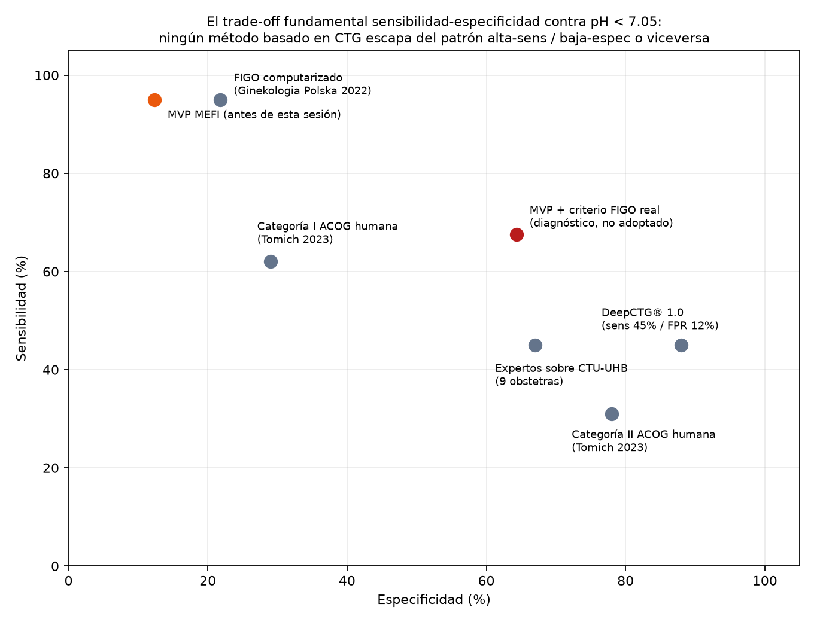
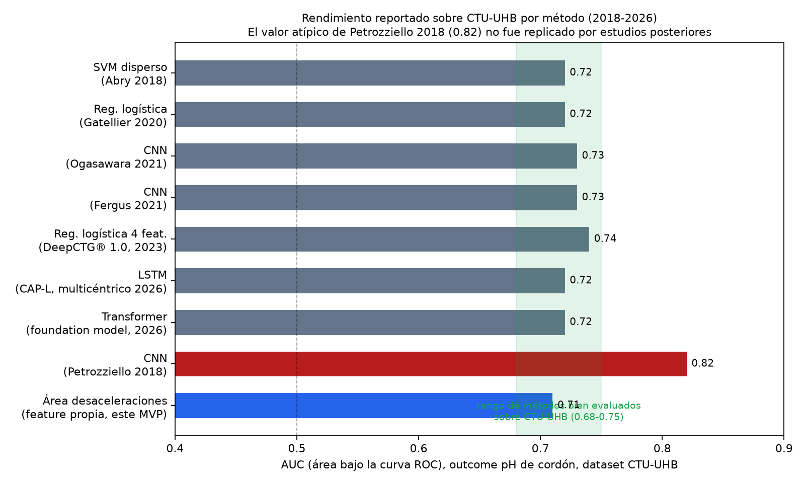

# Estado del arte: análisis automático de cardiotocografía intraparto (actualización octubre 2026)

**Proyecto:** Asesor Clínico MEFI — Hospital Dr. Gustavo Fricke
**Fecha:** 13 de octubre de 2026
**Alcance:** IA aplicada a interpretación de CTG/EFM fetal intraparto — clasificación FIGO asistida por computador, aprendizaje profundo sobre FHR+UC, detección de contracciones uterinas, datasets abiertos (CTU-UHB), validación contra pH de cordón, evidencia clínica de sistemas de apoyo a la decisión, y digitalización de trazados en papel. Este documento reemplaza y amplía la investigación de agosto de 2026 (§1.2 de CHECKPOINT.md).

---

## Resumen ejecutivo

La pregunta que motiva esta actualización es si la especificidad baja del clasificador FIGO del MVP (95% sensibilidad / ~12% especificidad contra pH < 7.05 en CTU-UHB) es un defecto del implementación o una propiedad del problema. La evidencia 2018-2026 es contundente: es una propiedad del problema. Ningún método basado en CTG —ni reglas FIGO computarizadas, ni aprendizaje profundo multicéntrico, ni expertos obstétricos humanos— supera un AUC de ~0.75 predictendo acidemia fetal desde el trazado CTG sobre el dataset público CTU-UHB. La especificidad baja con sensibilidad alta es exactamente el patrón que las propias guías FIGO 2015 describen ("sensitive indicators, but low specificity and low positive predictive value") y que el ensayo INFANT (Lancet 2017) ejemplificó a escala clínica.

Consecuencias prácticas para este proyecto: (1) el clasificador por reglas se mantiene como está, orientado a sensibilidad; (2) se adoptó un detector de contracciones con respaldo en la literatura de procesamiento de señal TOCO, que hace fisiológicamente plausible el conteo (mediana 11-17 contracciones por registro de ~80 min frente a las 90 del detector anterior) y habilita el criterio NICE de tachisistolia como 4ª variable del semáforo; (3) se incorpora el área bajo las desaceleraciones como medida de severidad cuantitativa, por ser la feature individual con mejor discriminación documentada; (4) la validación ahora reporta PPV/NPV/exactitud balanceada y AUROC por feature, alineada con la métrica de la literatura. El intento de reemplazar el proxy de "desaceleraciones repetitivas" por el criterio real de FIGO (>50% de contracciones) se re-evaluó con el detector nuevo y se confirmó como no adoptable: sube la especificidad a ~64% pero baja la sensibilidad a ~67.5%, un intercambio que viola la regla de oro del proyecto.

---

## 1. El techo de rendimiento sobre CTU-UHB: AUC 0.68-0.75

CTU-UHB (552 registros intraparto, FHR+UC a 4 Hz, outcome de pH de cordón, 40 casos con pH < 7.05) sigue siendo el único benchmark público de escala. Un análisis reciente de modelos fundación (arXiv, enero 2026) resume el consenso: "los métodos correctamente evaluados alcanzan AUC de 0.68-0.75 sobre este dataset", y advierte que los valores >0.9 reportados en parte de la literatura reflejan datos privados sin validación independiente o problemas metodológicos (fugas, surrogates de outcome como Apgar, validación cruzada sobre registros del mismo paciente).

La tabla comparativa de DeepCTG® 1.0 (Frontiers in Pediatrics, 2023) es la referencia canónica: regresión logística sobre CTU-UHB (Gatellier 2020) AUC 0.72; SVM disperso (Abry 2018) 0.72; CNN entrenado en Oxford y evaluado en CTU-UHB (Petrozziello 2018) 0.82 — valor atípico no replicado; CNN entrenado y evaluado en CTU-UHB (Ogasawara 2021) 0.73; CNN (Fergus 2021) 0.73; y el propio DeepCTG® 1.0 (regresión logística con 4 features interpretables) 0.74 (IC 95% 0.66-0.81). En 2026, los modelos CAP (CNN/Transformer/LSTM/CfC) entrenados con 20.780 trazados de tres hospitales terciarios alcanzaron AUROC 0.709-0.730 al validarse externamente sobre CTU-UHB, superando a 10.571 respuestas de expertos humanos (0.715) en comparación nacional — pero sin escapar del rango 0.68-0.75.

| Método | Entrenamiento | Evaluación | Métrica principal | Fuente |
|---|---|---|---|---|
| Reg. logística | CTU-UHB | CTU-UHB (439 casos) | AUC 0.72 | Gatellier 2020, vía DeepCTG® 1.0 |
| SVM disperso | Lyon | CTU-UHB (472 casos) | AUC 0.72 | Abry 2018, vía DeepCTG® 1.0 |
| CNN | Oxford | CTU-UHB | AUC 0.82 (no replicado) | Petrozziello 2018 |
| CNN | CTU-UHB | CTU-UHB | AUC 0.73 (IC 0.69-0.77) | Ogasawara 2021 |
| Reg. logística 4 feat. | SPaM, Beaujon | CTU-UHB | AUC 0.74 (IC 0.66-0.81) | [DeepCTG® 1.0, 2023](https://pmc.ncbi.nlm.nih.gov/articles/PMC10311205/) |
| CNN-BiLSTM (atención) | CTU-UHB (CV) | CTU-UHB | Acc 93.1% / sens 93.1% / spec 94.1% (con SMOTE; posible sobreajuste) | [Digital Signal Processing, 2025](https://www.sciencedirect.com/science/article/abs/pii/S1051200425002817) |
| 1D-SEResNet50 | 14 hospitales, 22.522 partos | 3 datasets externos | AUC 0.862-0.895 (datos propios); NPV ~0.95 | [Park et al., Sci Rep 2025](https://pmc.ncbi.nlm.nih.gov/articles/PMC12137656/) |
| CAP-L (LSTM) | 20.780 CTG, 3 hospitales | CTU-UHB + comparación con 10.571 expertos | AUROC 0.709-0.730 | [BMC Medicine, 2026](https://link.springer.com/article/10.1186/s12916-026-04794-z) |
| Modelo fundación (transformer) | — | — | afirma techo 0.68-0.75 sobre CTU-UHB | [arXiv 2601.06149, 2026](https://arxiv.org/html/2601.06149v1) |
| **MVP MEFI (este proyecto)** | reglas FIGO/NICE | CTU-UHB (552) | sens 95% / spec 11-12%; feature área-desaceleraciones AUC 0.71 | validación propia, oct 2026 |

La lectura operativa es que este MVP, con su clasificador binario de alto recuerdo, no está lejos del frente de lo publicado en la dimensión que la literatura usa para comparar. Su feature de área bajo las desaceleraciones (AUC 0.71 sobre los 552 registros) coincide con la feature principal de DeepCTG® (`dec_area`) y con la literatura de áreas CTG como predictor de acidemia.

## 2. La especificidad baja es una propiedad de las categorías FIGO, no un bug

Más allá del AUC, la pregunta clínica es qué esperar de las categorías FIGO/ACOG/NICE como test binario frente a acidemia. Los datos clínicos son consistentes: Tomich et al. (2023, PMC10185048) en embarazos de bajo riesgo encontraron sensibilidades de 62%/31%/6% y PPV de 11%/16%/10% para las categorías I/II/III de ACOG frente a acidemia (pH < 7.1), sin asociación significativa entre categoría y outcome; el PPV de ~11% de una categoría II es casi idéntico al 7.7% que mide nuestro batch. Un estudio de embarazos gemelares con interpretación humana (Ginekologia Polska 2022) reportó para criterios FIGO computarizados una sensibilidad de 95% con especificidad de 21.8% — espejo casi exacto de las 95%/12.3% de este MVP antes de esta sesión.

Las propias guías lo reconocen. El consenso FIGO 2015 indica que los patrones CTG son "sensitive indicators, but have a low specificity and low positive predictive value", y las recomendaciones NICE NG229 estructuran su semáforo precisamente para gestionar ese hecho: la categoría comunica estado, no diagnóstico. Incluso los expertos humanos sobre CTU-UHB, en el estudio de 100 casos que alimentó la comparación con DeepCTG, operaban a sensibilidad ~45% / especificidad ~67%. El corolario para el proyecto es que perseguir especificidad >50% manteniendo sensibilidad ≥95% con reglas FIGO es contradecir dos décadas de evidencia; el trade-off existe y cualquier mejora futura vendría de scores continuos calibrados (tipo DeepCTG), no de re-umbralizar categorías.

## 3. Qué features predicen: área de desaceleraciones, no conteos ni contracciones aisladas

El análisis univariado de DeepCTG® 1.0 es la evidencia más directa para decidir dónde invertir: todas las features basadas en aceleraciones/desaceleraciones fueron estadísticamente significativas, y las de mejor AUC univariado fueron el área cubierta por aceleraciones y el área cubierta por desaceleraciones. Las features basadas en contracciones por sí solas **no fueron significativas**; las features conjuntas contracción-desaceleración aportaban poco sobre las de desaceleración pura por alta correlación. El modelo final usa solo cuatro features: mínimo y máximo de línea base, área de aceleraciones y área de desaceleraciones (AUC de validación 0.757 con 4 features vs 0.750 con 25).

Este hallazgo, replicado en nuestro batch (AUROC: área de desaceleraciones 0.710 > línea base 0.624 > variabilidad 0.561 > nº desaceleraciones 0.536), motivó dos decisiones adoptadas: exponer el área total bajo las desaceleraciones como severidad cuantitativa en el informe (sin alterar la clasificación por categorías), y dejar de intentar que la información de contracciones mejore la especificidad por sí sola. El ensayo INFANT-Guardian ya había mostrado en la práctica que features avanzadas de variabilidad de corto plazo no mejoraban los desenlaces pese a mejorar métricas de clasificación.

## 4. Detección automática de contracciones uterinas (TOCO)

El segundo bloque de investigación cubrió el detector de picos de UA, que el 26 de agosto se identificó como el cuello de botella para usar el criterio real de FIGO ("desaceleraciones repetitivas" = asociadas a >50% de las contracciones). La literatura de procesamiento de señal TOCO converge en un pipeline clásico: re-muestreo a grilla regular, filtrado de respiración materna (0.2-0.5 Hz) con pasabajos ~0.04 Hz zero-phase, tono basal por mediana móvil larga o histograma en ventanas de 4-6 minutos, y detección de picos con umbrales relativos al tono basal (el algoritmo clásico tipo Dawood-Redman/Sonicaid exige >30 s sobre tono+10 unidades y amplitud >20 unidades; el enfoque de Stony Brook con procesos gaussianos usa normalización en ventana móvil de 6 min). Un matiz fisiológico relevante del mismo cuerpo de literatura: el TOCO mide cambio de contorno abdominal, no presión intrauterina, deforma picos y captura artefactos de movimiento — por eso sus picos sirven para cronometría y frecuencia, no para intensidad.

El detector v2 implementado (§-1 de CHECKPOINT.md) sigue exactamente ese pipeline con umbrales escalon-robustos (prominencia = máx(15% del rango robusto p95-p20, 4σ del ruido estimado en el tramo inferior de la señal, piso absoluto de 3 unidades), separación mínima 45 s, duración mínima 30 s al 50% de prominencia). Sobre CTU-UHB produce una mediana de 11-17 contracciones por registro (~1.5-2.4 por 10 minutos, rango p5-p95 de 3-26), frente a las 90 (12.6/10 min) del detector naive anterior, que eran incompatible con la fisiología y la causa raíz del fracaso del 26 de agosto. El estimador de ruido en el tramo inferior (percentil 40 hacia abajo) resuelve el problema del MAD global, que quedaba inflado por las propias contracciones cuando su duty cycle es alto.

## 5. Aprendizaje profundo: qué se puede y qué no se puede replicar en este MVP

El panorama 2024-2026 del DL en CTG es genuinamente alentador en escala hospitalaria —estudios multicéntricos con 20.000+ trazados muestran AUC 0.86-0.89 en validación interna y externa, NPV ~0.95, y rendimiento superior al de expertos— pero esas cifras descansan en tres ingredientes que este proyecto no tiene: decenas de miles de trazados etiquetados por obstetras, señal digital nativa a 4 Hz (no digitalizada desde papel), y validación externa multicéntrica. Sobre el único benchmark público comparable, esos mismos modelos caen a AUC ~0.71-0.73. Además persisten las advertencias de reproducibilidad: modelos con "accuracy 96-99%" sobre CTU-UHB usan surrogates de outcome (Apgar) o validación con fugas, y la comparación honesta ( foundation model, enero 2026) fija el techo en 0.68-0.75.

La arquitectura deliberada de este MVP —digitalización determinística auditable + clasificación por reglas explícitas + LLM solo redactando sobre features— sigue siendo defendible frente al estado del arte: los sistemas interpretables de features clásicas (DeepCTG) igualan a arquitecturas DL sobre el benchmark público, y la evidencia clínica (siguiente sección) recuerda que métricas de clasificación no se traducen automáticamente en beneficio. La ruta de mejora realista a futuro no es reemplazar el pipeline por un DL end-to-end, sino (a) calibrar un score continuo de riesgo tipo DeepCTG sobre CTU-UHB y validarlo localmente, y (b) solo cuando el hospital tenga volumen propio etiquetado, entrenar un modelo local. Ninguna de las dos requiere cambiar la arquitectura de separación digitizador/clasificador/redactor.

## 6. Evidencia clínica: precisión de clasificación ≠ beneficio neonatal

El marco de precaución del proyecto (ensayo INFANT, Lancet 2017) no ha cambiado de dirección; si acaso se ha reforzado. La meta-análisis en red CMAJ 2021 sobre vigilancia intraparto concluyó que ningún método evaluado (EFM, EFM+ST, muestreo fetal) redujo la acidemia neonatal, admisiones a UCIN, Apgar bajo o muerte perinatal, y que el EFM se asocia a aumento de cesáreas. El ensayo INFANT mostró específicamente que un sistema computarizado de interpretación CTG con alertas no mejoró desenlaces pese a su precisión. Revisiones de algoritmos estandarizados (scoping review 2025) repiten el patrón: más detección de patrones anormales y mejor acuerdo inter-evaluador, sin mejora de outcomes.

Dos líneas nuevas merecen seguimiento. Primero, el estudio finlandés de Philips (junio 2025, ~214.000 recién nacidos a término) asoció el monitoreo FHR por transductor ultrasónico externo sin registro simultáneo de frecuencia cardíaca materna a mayor riesgo de desenlaces por asfixia — argumento a favor de incorporar canal MHR si el hardware del hospital lo permite (futuro). Segundo, la evidencia sobre tipos de hipoxia por morfología de desaceleración (consenso fisiológico internacional 2018, revisión 2024) que ya usa `prompts.py` sigue siendo el marco fisiopatológico aceptado, y los mapas Grad-CAM de los CAP 2026 confirman que los modelos DL ponderan fundamentalmente desaceleraciones variables y prolongadas — convergencia independiente con las features clásicas.

## 7. Digitalización de trazados en papel

La investigación original (agosto 2026) estableció que ningún VLM genérico lee coordenadas numéricas de forma confiable desde un gráfico; la literatura 2020-2025 de digitalización CTG/ECG en papel respalda el enfoque de visión clásica de `digitizer.py`. Los métodos clásicos de eliminación de grilla + seguimiento de curva alcanzan correlación 0.985-0.99 con la señal de referencia (ej. método de grilla binaria para fotos de smartphone, 2020), y los enfoques con DL sobre escaneados (Frasch et al. 2021, detección de eventos con SSD sobre 252 páginas) operan sobre muestras pequeñas y de calidad controlada. La arquitectura en dos pasos con calibración por 2 clics del clínico sigue siendo la opción auditable correcta para un hospital que recibe fotos/escaneos heterogéneos; el margen de mejora identificado en la revisión de código no está en el extractor sino en la detección automática de paneles (heurística admitidamente aproximada) y en un posible cambio de seguimiento por continuidad a programación dinámica tipo Viterbi, usada en los pipelines ECG de última generación.

## 8. Guías vigentes relevantes para el clasificador

NICE NG229 (2022, con enmiendas 2025) sigue siendo la guía operativa del semáforo del MVP, y su versión vigente precisa dos detalles que esta sesión incorporó o dejó anotados. La definición de "repetitivas" coincide con FIGO: desaceleraciones que ocurren con más del 50% de las contracciones. La categorización de desaceleraciones fue enmendada en 2025: "rojo" incluye desaceleraciones variables repetitivas con características preocupantes por >30 min, desaceleraciones tardías, bradicardia aguda o **una desaceleración prolongada única de 3 minutos o más** — el MVP usa 5 minutos como criterio patológico directo (flag `muy_prolongada`), más permisivo que NICE 2025 en este punto; es una diferencia deliberada conservadora (la propia FIGO 2015 usa umbrales de 3-5 min según el criterio), pero queda registrada como divergencia a revisar con validación clínica. La frecuencia de contracciones es la 4ª variable del semáforo (blanco <5/10 min; ámbar ≥5/10 min o hipertono) y fue incorporada como tal en esta sesión.

## 9. Decisiones adoptadas y límites declarados

| Decisión | Evidencia | Estado |
|---|---|---|
| Mantener clasificador por reglas, orientado a sensibilidad | AUC CTU-UHB 0.68-0.75 para todo método; FIGO = indicador sensible, PPV bajo | Confirmado |
| Detector de contracciones v2 (pasabajos 0.04 Hz + tono móvil + find_peaks robusto) | Pipeline clásico TOCO (Stony Brook, Dawood-Redman); conteo fisiológico 11-17/registro | Adoptado (13-oct-2026) |
| Criterio NICE de tachisistolia (≥5 contracciones/10 min) como 4ª variable del semáforo | NICE NG229 §1.4.12-1.4.14 | Adoptado; costo medido: 0 registros afectados en CTU-UHB |
| Área bajo desaceleraciones como severidad en informe | DeepCTG features; AUC propia 0.71 | Adoptado |
| PPV/NPV/balanced accuracy + AUROC por feature en validación | Métrica estándar de la literatura | Adoptado |
| Criterio FIGO real (>50% contracciones) en vez del proxy | Mejora especificidad (64%) pero sensibilidad cae a 67.5% | **No adoptado** (regla de oro del proyecto) |
| Score continuo de riesgo tipo DeepCTG calibrado | AUC 0.74 publicado con 4 features | Propuesta futura |
| Modelo DL end-to-end | Requiere volumen propio etiquetado + señal nativa 4 Hz | Descartado por ahora |
| Incorporar canal de frecuencia cardíaca materna | Estudio Finlandia 2025 (~214k casos) | Futuro, depende de hardware |

**Limitaciones de esta investigación:** búsqueda web con acceso a resúmenes y textos completos abiertos (no a bases bibliográficas de suscripción); algunas cifras (especialmente AUC de estudios privados) provienen de tablas secundarias de revisiones y no del artículo primario; el estado del arte se actualizó a octubre de 2026 y debe revisarse antes de decisiones de producción.

---

*Este documento es material de trabajo interno del proyecto con fines de investigación y desarrollo. No constituye consejo clínico ni validación regulatoria de ningún sistema; las cifras de rendimiento sobre CTU-UHB no son transferibles a la población del Hospital Gustavo Fricke sin validación local.*
